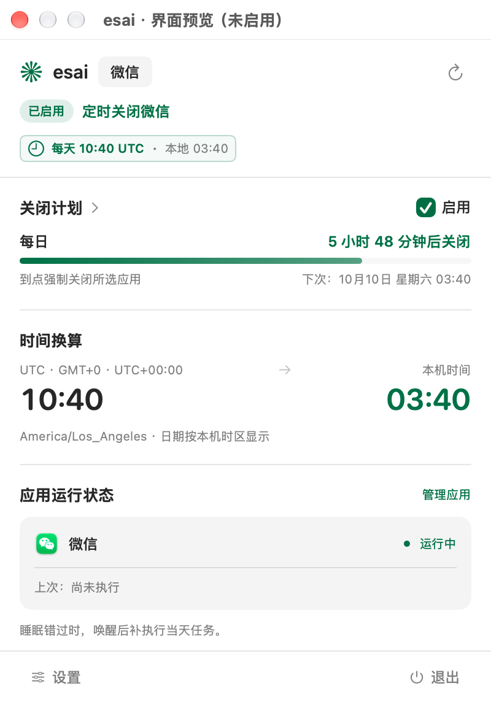

<div align="center">


# esai 定时关闭

**下班总忘记登出电脑微信？我来帮你。**

原生 macOS 状态栏应用，按每日计划关闭微信或你选定的多个应用。

[](https://github.com/fitzsmith2000/esai/releases/latest)


[](LICENSE)

[下载安装包](https://github.com/fitzsmith2000/esai/releases/latest) · [English](README_EN.md) · [反馈问题](https://github.com/fitzsmith2000/esai/issues)

</div>

## 亮点

- **常驻状态栏**：轻巧的 esai 花朵图标，点开就能查看倒计时、下次执行时间和应用运行状态。
- **微信默认，多应用可选**：搜索已安装的应用，或从其他目录添加 `.app`，按同一计划一起关闭。
- **按你所在的时区安排**：UTC、美西、美东、伦敦、北京、东京可选，自动换算本机时间。
- **自动处理夏令时**：地区计划保持当地钟表时间；UTC 计划全年固定。
- **睡眠后补执行**：唤醒后补执行当天已到期的任务，每天最多执行一次。
- **原生 Liquid Glass**：macOS 26 及以上支持玻璃控件和分段标签的流动切换，旧版系统使用兼容样式。
- **你的颜色、你的语言**：六种经典强调色、自定义 HEX 和取色器；浅色、深色、跟随系统；简体中文、English、语言自动跟随。
- **轻量、本地运行**：v1.5.3 的 DMG 约 **1.21 MB**，应用本体约 **2.72 MB**，无需登录账号。

## 界面预览

以下为应用的独立预览模式截图；时间换算和运行状态会随本机环境变化。

<table>
<tr>
<td align="center"><b>状态与倒计时</b><br /></td>
<td align="center"><b>时间与时区</b><br /></td>
</tr>
<tr>
<td align="center"><b>应用选择</b><br /></td>
<td align="center"><b>外观与强调色</b><br /></td>
</tr>
</table>

## 安装

### 系统要求

- Apple Silicon Mac（M 系列芯片），macOS 13 或更新版本。
- Liquid Glass 效果需要 macOS 26 或更新版本。
- 当前安装包为 arm64 版本，暂未提供 Intel 版本。

### 手动安装

1. 前往 [GitHub Releases](https://github.com/fitzsmith2000/esai/releases/latest) 下载 `esai-1.5.3-apple-silicon.dmg`。
2. 打开 DMG，将「esai 定时关闭」拖入 `Applications`。
3. 打开应用，点击状态栏花朵图标。

当前版本使用 ad-hoc 签名，尚未经过 Apple 公证。如果系统阻止首次打开，可在「系统设置 → 隐私与安全性」中选择「仍要打开」，再确认启动。

## 开始使用

1. 打开「设置 → 关闭应用」，确认需要关闭的应用；默认选择微信。
2. 在「设置 → 计划」选择小时、分钟和时区，查看换算预览，点击「保存时间」。默认计划为 **每天 10:40 UTC**。
3. 返回首页，勾选「启用」。

设置分为「计划」「关闭应用」「外观」「通用」四页。首页的「关闭计划」直接进入时间设置，「管理应用」直接进入应用选择。「通用」中可设置语言与登录启动。

**任务会强制关闭所选应用，未保存的内容可能丢失。** 请仅选择你希望到点关闭的软件。

## 时间与执行规则

| 计划时区 | 时区标识 | 夏令时 |
| --- | --- | --- |
| UTC | `UTC` | 全年固定 |
| 美西 · 洛杉矶 | `America/Los_Angeles` | 自动跟随当地规则 |
| 美东 · 纽约 | `America/New_York` | 自动跟随当地规则 |
| 英国 · 伦敦 | `Europe/London` | 自动跟随当地规则 |
| 中国 · 北京 | `Asia/Shanghai` | 当前不切换 |
| 日本 · 东京 | `Asia/Tokyo` | 当前不切换 |

例如，美西每天 10:40 在冬令时对应 UTC 18:40，在夏令时对应 UTC 17:40。改变电脑本机时区只改变换算显示，计划仍按选定地区执行。

- 首次启动默认未启用。当天时间已过时再启用，会预约下一次任务。
- 保存时间不会自动启用，也不会立即关闭应用。
- 睡眠期间不会主动唤醒电脑；唤醒或重启 esai 后，只补执行当前**计划时区日期**已到期的任务，历史任务不累计。
- 春季跳时遇到不存在的时间，例如 02:30，当天顺延为 03:30；秋季重复的小时选择第一次，当天只执行一次。
- 取消「启用」立即撤销后续调度。「退出」停止调度，应用需要保持运行。
- 所有已选应用共享一个每日计划。取消全部应用时自动停用，再次选择后需要主动启用。
- 按应用的精确 bundle ID 匹配；关闭失败不影响其他目标。执行后重新打开的应用不会被本次任务再次关闭。

## 隐私

计划、应用选择、外观、语言与执行记录保存在本机偏好设置中。应用在本地读取已安装应用的信息和运行状态，不上传这些数据，也没有账号登录、遥测或网络请求功能。不需要辅助功能或自动化权限。

## 从源码构建

需要 Apple Silicon Mac、含 macOS 26 SDK 的 Xcode 26 或更新工具链，以及命令行工具。构建产物的最低运行版本为 macOS 13。

```sh
git clone https://github.com/fitzsmith2000/esai.git
cd esai
zsh build.sh
```

生成应用：`build/esai 定时关闭.app`。图标、许可证和构建脚本均包含在仓库内，无需下载参考项目。

```sh
# 时间规则、偏好迁移、多应用执行等逻辑检查；不关闭真实应用
zsh test.sh

# 构建应用，并生成可拖入 Applications 的压缩 DMG
zsh package.sh
```

只读界面预览不会启动关闭任务或修改正式设置：

```sh
ESAI_PREVIEW_PATH="$PWD/build/preview.png" \
  "build/esai 定时关闭.app/Contents/MacOS/EsaiWeChatTimer" --preview
```

预览可附加 `--preview-settings`、`--preview-apps`、`--preview-colors`、`--preview-general` 或 `--preview-dark`。

## 致谢与许可证

界面设计参考 [Codex Runway](https://github.com/Licoy/codex-runway)。部分 UI 组件改编自其源码，保留原作者与贡献者的版权和许可证声明；具体来源见 [THIRD_PARTY_NOTICES.md](THIRD_PARTY_NOTICES.md)。

本项目采用 [GNU AGPL-3.0](LICENSE)。发布版本对应的源码可在相同版本的 Git 标签中获取。
