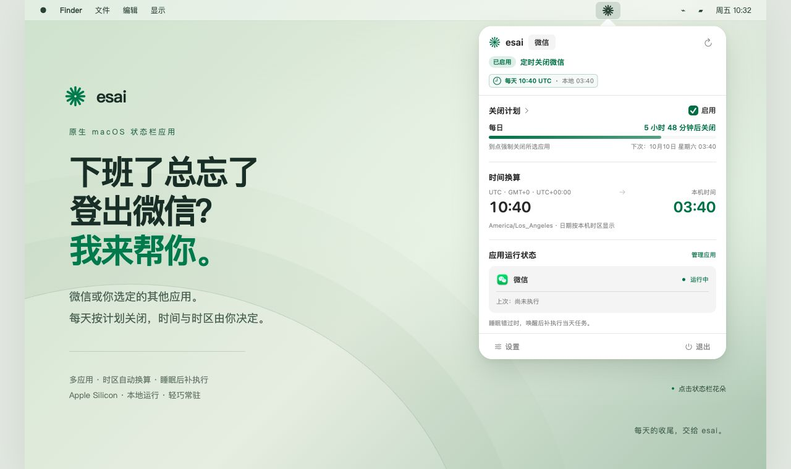
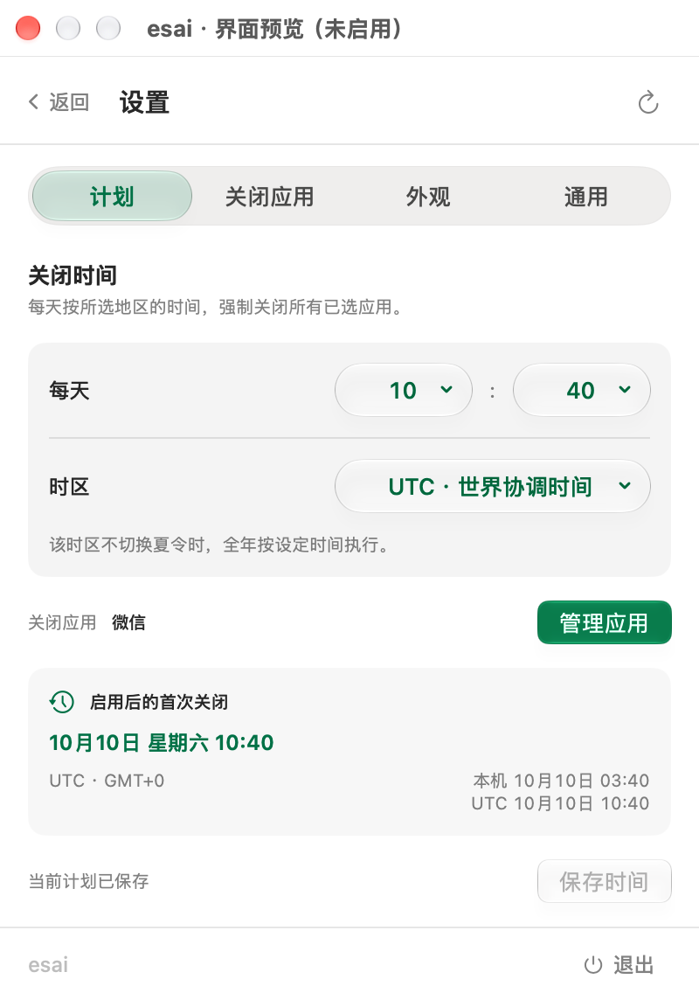
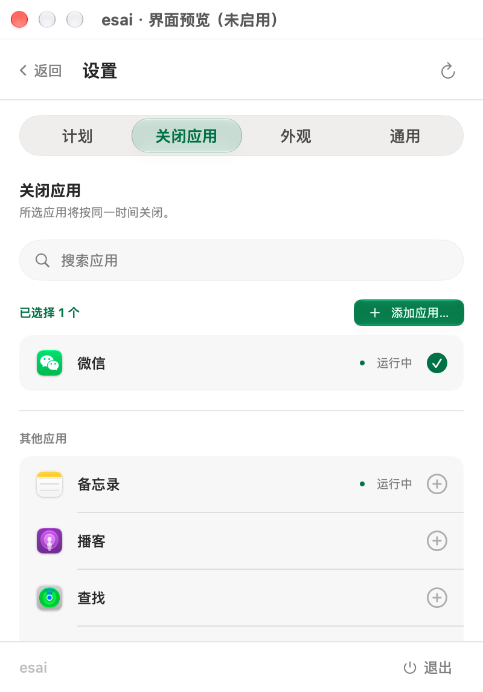
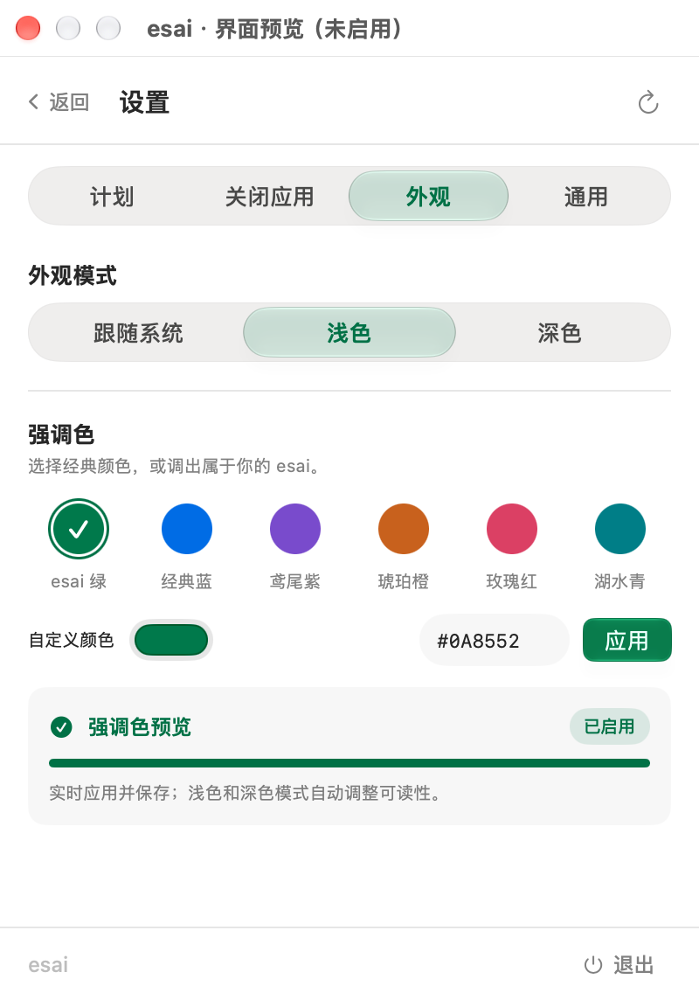

<div align="center">


# esai

**Forgot to log out of WeChat after work? I've got you.**

A native macOS menu bar app that closes WeChat or multiple selected apps on a daily schedule.

[Download](https://github.com/fitzsmith2000/esai/releases/latest) · [简体中文](README.md) · [Report an issue](https://github.com/fitzsmith2000/esai/issues)

</div>



## Features

- Menu bar flower icon with countdown, next execution time, and app status.
- WeChat selected by default; choose multiple installed apps or add `.app` bundles from other folders.
- Configurable time in UTC, Los Angeles, New York, London, Beijing, or Tokyo, with local time conversion and automatic daylight saving handling.
- Catch up after wake for the current schedule date, with at most one execution per day.
- Native Liquid Glass controls and flowing tab selection on macOS 26 or later, with compatible controls on older systems.
- Six accent presets, custom HEX colors, and a color picker; light, dark, or system appearance.
- English, Simplified Chinese, or automatic system language.
- Local operation without accounts or telemetry. v1.5.3: approximately 1.21 MB DMG and 2.72 MB app.

## More screenshots

The hero uses a real esai interface capture with a composed desktop and menu bar. Screenshots use Simplified Chinese; the app also supports English.

<details>
<summary>Schedule: daily time, time zone, and local/UTC conversion</summary>



</details>

<details>
<summary>Apps: WeChat by default, with multiple apps supported</summary>



</details>

<details>
<summary>Appearance: Liquid Glass and custom accent colors</summary>



</details>

## Install

Requires an Apple Silicon Mac running macOS 13 or later. Liquid Glass requires macOS 26 or later. An Intel build is not currently available.

Download the DMG from [Releases](https://github.com/fitzsmith2000/esai/releases/latest), open it, and drag the app into `Applications`.

This release is ad-hoc signed and has not been notarized by Apple. If macOS blocks the first launch, use **System Settings → Privacy & Security → Open Anyway**, then confirm.

## Use

1. Choose your apps under **Settings → Apps**; WeChat is the default.
2. Set the daily time and time zone under **Settings → Schedule**, then save. The default is **10:40 UTC**.
3. Return to the dashboard and enable the schedule.

**Selected apps are force-terminated. Unsaved work may be lost.**

The app must remain running. Quitting stops scheduling. You can enable launch at login under General settings.

## Scheduling rules

Regional schedules preserve their local wall-clock time across daylight saving changes; UTC schedules stay fixed. Changing your Mac's time zone only changes the conversion display.

Saving a schedule does not enable it or immediately close apps. Enabling after today's scheduled time schedules the next occurrence. After sleep or an app restart, only a due task for the current date in the schedule's time zone is caught up; older missed dates are skipped.

During a spring gap, an unavailable 02:30 becomes 03:30 for that day. During a repeated fall hour, the first occurrence is used. Each date is handled at most once.

All selected apps share one schedule. Clearing the selection disables scheduling. Apps are matched by exact bundle ID; failure for one app does not block the others, and reopening an app after execution does not cause it to be closed again by that task.

## Privacy

Settings and execution records stay in local preferences. Installed app information and running status are read locally and are not uploaded. No accounts, telemetry, network requests, Accessibility permission, or Automation permission are required for normal operation.

## Build

Requires Apple Silicon and Xcode 26 or later with the macOS 26 SDK and command line tools. The deployment target is macOS 13.

```sh
git clone https://github.com/fitzsmith2000/esai.git
cd esai
zsh build.sh
zsh test.sh
zsh package.sh
```

The app is generated in `build/`; the compressed installer is generated in `dist/`. The logic tests do not terminate real apps.

## Credits and license

The interface draws inspiration from [Codex Runway](https://github.com/Licoy/codex-runway), and some UI components adapt its source. See [THIRD_PARTY_NOTICES.md](THIRD_PARTY_NOTICES.md) for attribution.

Licensed under [GNU AGPL-3.0](LICENSE). Corresponding release source is available at the matching Git tag.
